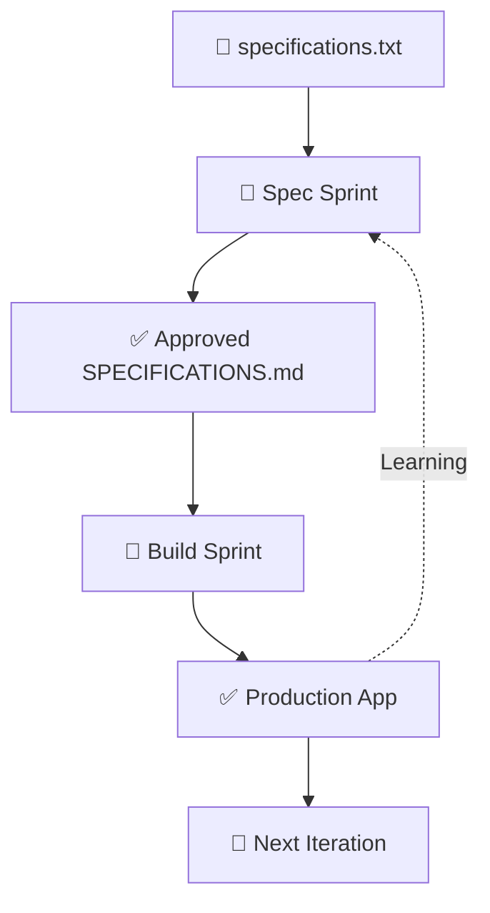

# 🚀 Agile SpecFirst: The Future of AI-Native Development

## **Traditional Agile vs. Agile SpecFirst**

| Traditional Agile | Agile SpecFirst |
|-------------------|-----------------|
| Code → Test → Deploy | Spec → Generate → Validate |
| Manual Development | AI-Powered Generation |
| Requirements Change | Specifications Evolve |
| Tech Stack Lock-in | Technology Agnostic |

---

## **🔄 The Dual-Loop Revolution**

### **Loop 1: Specification Refinement** *(1-2 week sprints)*
```
📝 specifications.txt → 🧭 Spec Sprint → ✅ Approved SPECIFICATIONS.md
```
**Key Innovation**: Stakeholders collaborate on *what* to build, not *how*

### **Loop 2: Implementation Generation** *(1-2 week sprints)*
```
✅ SPECIFICATIONS.md → 🚧 Build Sprint → ✅ Production App
```
**Key Innovation**: AI generates production-ready code from validated specs

---

## **🎯 Game-Changing Benefits**

### **75% Faster Development**
- No manual coding of standard patterns
- Instant technology stack switching
- Validated specifications = working applications

### **Technology Freedom**
- Same spec → Python Flask, Node.js, Go, Rust
- Break free from legacy constraints
- Future-proof your architecture

### **Quality Consistency**
- AI follows best practices every time
- Comprehensive testing generated automatically
- Security patterns built-in

### **Stakeholder Alignment**
- Everyone understands natural language specs
- No miscommunication between business and tech
- Continuous validation through working software

---

## **📊 Proven Results**

| Metric | Traditional | Agile SpecFirst |
|--------|-------------|-----------------|
| **Time to Production** | 2-6 months | 1-2 weeks |
| **Technology Migration** | 6-12 months | 1-2 days |
| **Requirement Clarity** | 60-70% | 95%+ |
| **Code Quality Consistency** | Variable | 8.5/10+ |

---

## **🛠️ Real-World Applications**

### **Enterprise**: 
Standardize development across teams, enable rapid tech migration

### **Startups**: 
MVP in days, not months. Pivot technology stacks without rewriting

### **Consulting**: 
Deliver consistent quality across diverse client projects

### **Open Source**: 
Community contributes specifications, AI generates implementations

---

## **🎪 The Process in Action**



---

## **💡 Key Success Factors**

### **Specification Quality**
- ✅ **Completeness Test**: Can another AI regenerate the entire app?
- ✅ **Stakeholder Approval**: Business validates every requirement
- ✅ **Acceptance Criteria**: Every feature has measurable success metrics

### **Implementation Excellence**
- ✅ **Production-Ready**: Generated code includes error handling, security, tests
- ✅ **Real-World Focus**: Applications ready for actual deployment
- ✅ **Continuous Learning**: Implementation gaps improve specification quality

---

## **🚀 Getting Started**

### **Week 1**: Setup
- Create specification backlog
- Define stakeholder roles
- Establish Definition of Done

### **Week 2-3**: First Spec Sprint
- Refine 1-2 specification areas
- Get stakeholder sign-off
- Validate completeness

### **Week 4-5**: First Build Sprint
- Generate implementation from specs
- Test against acceptance criteria
- Document specification improvements

### **Week 6+**: Scale
- Run parallel spec/build sprints
- Build pattern library
- Continuously improve both loops

---

## **🎯 The Bottom Line**

### **Agile SpecFirst = Agile + AI + Specifications**

**Traditional Development**: Write code → Hope it meets requirements

**Agile SpecFirst**: Validate requirements → Generate perfect code

---

## **🔗 Ready to Transform Your Development?**

**The future of software is specification-driven, technology-agnostic, and AI-native.**

**Start your Agile SpecFirst journey today:**
- Define your specifications clearly
- Let AI generate production-ready applications
- Iterate on requirements, not implementations

**#AgileSpecFirst #AINativeDevelopment #SpecificationDriven #TechnologyAgnostic #FutureOfDevelopment**

---

*Transform your development process from code-centric to specification-centric. Build applications the way they were meant to be built in the AI era.* 